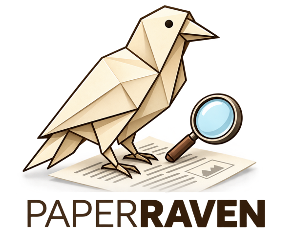
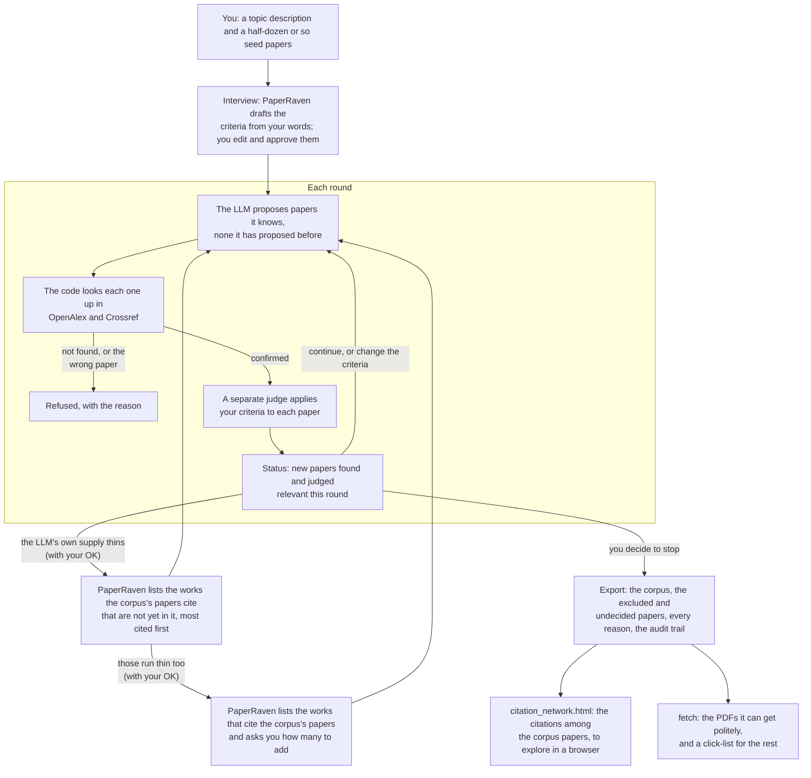

# PaperRaven

<p align="center"></p>

A machine assistant for generating topic-bounded, verified samples of the scientific literature.

**See how it works:** [a short walk-through of one real run](https://aaronclauset.github.io/paperraven/).

**Input:** a few sentences or more describing your target topic, and a half-dozen or so example
papers as seeds.

**Output:** a corpus of real papers inside the topic boundary you set with PaperRaven. Every paper
is confirmed to exist by the scholarly bibliographic databases; relevance is judged by a model, with its
reasons recorded.

**An LLM generates; deterministic code verifies.** PaperRaven uses a large language model to
propose candidate papers and to judge their relevance. Its code owns every piece of state,
checks every DOI against OpenAlex and Crossref, and refuses anything it cannot confirm. Abstracts the databases lack
are looked up in Europe PMC, which is sent no email address. No model API key is needed and
there is no provider account. PaperRaven runs inside Claude Code: the model of your session
proposes papers, and a Sonnet-class subagent judges them, so judging cost stays flat however
strong the proposer. An optional, free OpenAlex key raises OpenAlex's daily
allowance (see Install).

Version 0.2.0 is the current release; [CHANGELOG.md](CHANGELOG.md) records what changes between versions.

## Install

You need Python 3.11 or later, git, and Claude Code (tested with version 2.1.284). In a new folder for your
literature work:

```bash
python3.11 -m venv .venv
.venv/bin/pip install git+https://github.com/aaronclauset/paperraven
.venv/bin/paperraven install-skill
```

On Windows: `py -3.11 -m venv .venv`, then `.venv\Scripts\pip install git+https://github.com/aaronclauset/paperraven`
and `.venv\Scripts\paperraven install-skill`.

`paperraven install-skill` writes the skill into this folder's `.claude/skills/paperraven/` and
its two subagents into `.claude/agents/`, with the path of the Python it was installed in, so
PaperRaven always runs the right one. Run it in the folder you will work in, not your home folder.
PaperRaven will ask you for a contact email; it goes only to OpenAlex and Crossref (see Privacy).

Optionally, put a free OpenAlex API key (from openalex.org) in a `.env` file in the same folder,
as `OPENALEX_API_KEY=<key>`. Without one, OpenAlex's keyless pool allows about 100 searches a
day, shared by everyone behind the same network address (a campus, say), which one run can use
up; when it runs out, PaperRaven carries on with Crossref and tells you.

**Upgrade:** `.venv/bin/pip install -U git+https://github.com/aaronclauset/paperraven`, then
`.venv/bin/paperraven install-skill` again, then start a new Claude Code session.
`paperraven check` says when the installed skill is out of date.

**Uninstall:** `.venv/bin/pip uninstall paperraven`, then delete `.claude/skills/paperraven/`,
`.claude/agents/paperraven-judge.md` and `.claude/agents/paperraven-closeout.md`.

## Use it

Start Claude Code in that folder and type:

```
/paperraven
```

PaperRaven interviews you — topic, a half-dozen or so seed PDFs on disk, how many papers you
want, a contact email — shows you the criteria it drafted from your words and argues against
them before you approve, and then runs the loop, checking in with you after the first round and
every five rounds after that. You decide when to stop, whether to mine the corpus's reference
lists and the works that cite it, how many papers to add from them, and whether to fetch the
PDFs.

## How it works



Your seed papers go straight into the corpus. In each round, PaperRaven asks the LLM to propose a
new batch of papers on your topic, and a separate judge agent accepts only those papers that
match your topic. When the LLM's recall of relevant papers runs thin, you can tell PaperRaven to
mine the reference lists of the papers already in your corpus for new proposals, sorted by how
many citations within your corpus they received. When those run thin too, PaperRaven can list
the works that cite the corpus's papers, ranked by how much of their reference list your corpus
makes up, and you choose how many papers to add from them. When rounds become consistently thin, it means the
literature inside your boundary is running out, and PaperRaven tells you so. Mid-run, you can
adjust the topic criteria to steer the LLM's proposals, and PaperRaven re-evaluates the papers
already judged by the steered criteria.

## Usage

Five test runs on version 0.1.0 (Opus 5.5 proposing; Sonnet 5 and 5.5 judging), on five topics,
returned 88 to 207 papers in 20 to 60 rounds, using 13.6M to 80.9M tokens each, most of them the
conversation re-read from the prompt cache, which counts less against your limits than new input.
Weighted by Anthropic's published cache rates, that is about 14k to 51k input tokens per paper
returned (28.7k for the middle run) and 0.9k to 1.9k output tokens. Longer runs cost more
per paper: the conversation grows every round, and changing the criteria mid-run re-judges every
paper already judged. A run left idle for more than an hour pays to read the whole conversation
in again, which was 11% to 20% of a run's cost in the tests. The rounds took 30 minutes to 2 hours
of activity, plus the time you take to answer, and fetching the PDFs took 6 to 16 minutes. Anthropic does not publish the size of a plan's five-hour allowance, so
check the session bar in `/usage` after the first few rounds to see how far a run will go on your
plan.

## Or drive it yourself

The commands, in the order a run uses them (`paperraven --help` lists them):

```
install-skill once   put the skill and its two agents in this project's .claude/
check     first     the OpenAlex key and the contact email; no network call
init      once      resolve seed PDFs, write round 1's context
seed      as needed resolve a seed PDF the automatic pass could not
context   per round render the prompt the LLM answers     -> context.md
submit    per round verify the LLM's proposals            <- proposals.json
judge     per round emit the judging worklist             -> judging_request.json
verdicts  per round apply the judge's answers             <- judging_response.json
references late     works the corpus cites, not yet in it -> reference_candidates.md
citing    later    works citing the corpus, not yet in it -> citing_candidates.md
steer     as needed apply a change to the criteria (re-judges what it changes)
status    anytime   discovery curve, stop signal
export    at end    the corpus: README, papers.bib, papers.csv, worklist, excluded, network, audit/
closeout  at end    check the deliverable and the scratchpad (reports; changes nothing)
fetch     after     the PDFs for any .bib, as a reference manager fetches them; a click-list for the rest
```

`.claude/skills/paperraven/INSTRUCTIONS.md`, written by `install-skill`, is the full procedure.

## What it gives you

Each run's working files live in `runs/<name>/` in your folder; `export` writes the corpus
beside them, as `<run-name>-corpus/`, and that folder is the one you keep:

- `README.md` — what was searched, by what, under which criteria (each marked as yours or as
  written by the tool), with what result: a flow table and a methods paragraph to adapt.
- `papers.bib` and `papers.csv` — the corpus, with the database's publication year, volume, issue
  and pages.
  With `--library your.bib`, `papers.csv` marks which papers you already have.
- `worklist.csv` — every paper with its best acquisition route, open access first.
- `excluded.csv` — each excluded paper, who excluded it, under which criterion, and why.
- `uncertain.csv` — the papers the judge could not decide, yours to rule on (only if there are
  any); they are not in `papers.bib` until you do.
- `citation_network.html` — the citations among the corpus papers, as a network to explore in a
  browser: hover for a paper's details, click to open it, drag a paper and its neighbours
  follow. It works offline, and is drawn for corpora of up to 500 papers. `citations.csv` holds
  the same citations as an edge list, keyed as in `papers.bib`, for Gephi, networkx or R.
- `audit/` — every record, every configuration, the judge prompts, the rejections, and a
  manifest of the files `export` wrote.

`fetch --bib <corpus>/papers.bib` (any `.bib` works) downloads what it can into a `pdfs/`
folder beside the `.bib` (or `--dest <folder>`), slowly and politely: up to 4 publishers at a
time, never more than one request every 10 s to a publisher, at most 25 per publisher, and it
stops asking a publisher at its first refusal. `--published-only` takes only the publishers'
versions (more papers then go on the click-list). It
recognises each PDF by its first page, so it is resumable. What it cannot get goes on
`click_list.html`; download those yourself (a campus network or VPN helps), then run it again
with `--collect <your downloads folder>` (it prints the usual path) to copy them in.

Before a run is called finished, `closeout` checks the export and the scratchpad of the Claude
Code session, and a read-only reviewer (`.claude/agents/paperraven-closeout.md`) reports what to
fix and what is yours to decide. Judges run as `.claude/agents/paperraven-judge.md`, which can read, write and
search the web, and nothing else.

## What you can rely on

These hold for every corpus, because PaperRaven's code enforces them, not its LLM:

- **Every paper exists.** Each one was matched to a record in OpenAlex or Crossref. A DOI the
  LLM gives is looked up, and the record's title must agree with the paper the LLM described; a
  proposal without a DOI is found by its title. The LLM cannot add a paper the databases do not
  have, and a DOI in the corpus is always the database's, never one the LLM made up.
- **The bibliographic details are the database's.** Titles, authors, year, venue, volume, issue
  and pages come from the database record, not from the LLM's memory.
- **Every decision is recorded, with who made it.** Each paper in the corpus or excluded from it
  carries the reason and its source: the judge, a ruling of yours, a year limit, or your seeds.
  Each criterion is marked as yours or as written by the tool.
- **Nothing disappears silently.** Every paper the LLM proposed is in the export somewhere:
  in the corpus, excluded, undecided, or refused with the reason (for example, no database
  record, or a DOI whose title did not match).
- **Year limits are rules.** They are applied to the publication dates the databases give, not
  left to a judge's reading. Seeds are kept whatever their year.
- **The export can be checked.** `audit/` holds every record, every version of the
  configuration, and the exact prompts the judges read, with a checksum of every file `export`
  wrote; `closeout` reports anything changed or added afterwards.

And what it cannot promise:

- **Completeness.** No tool that asks a model for papers can say how many it missed, and
  PaperRaven reports no coverage figure. It shows, round by round, how many new papers were
  found and judged relevant, and says when the LLM is running out of candidates.
- **Identical relevance calls.** Relevance is a model's judgement. Papers near the boundary can
  come out differently if judged again, which is why every reason is recorded and why
  `excluded.csv` and `uncertain.csv` are there for you to read.
- **The same corpus twice.** A second run on the same topic will find a similar corpus, not the
  same one. The audit trail records how this one was made.

## Privacy and ethics

**What PaperRaven lets its LLM do.** PaperRaven's code owns every file that records the run's
state; the LLM only proposes papers, judges them, and writes the answer files PaperRaven asks
for. Judging runs in a separate Claude Code subagent that can only read, write and search the
web, and the close-out review in one that can only read. PaperRaven's instructions tell the LLM
to ask you before any decision that is yours, and to mark a criterion as yours only when you have read and confirmed its words; to
treat paper titles and abstracts as data, never as instructions; never to make up a DOI; never
to download papers except through `fetch`; never to harvest candidates from reference lists on web pages or from citation services' pages (searching the web stays allowed), since PaperRaven reads the corpus's own reference lists, and the works that cite it, from OpenAlex; and never to read your `.env` file. The limits on the
two subagents are enforced by Claude Code; the rest are instructions the LLM follows.

**How it treats other people's sites.**
- **OpenAlex and Crossref**, to verify and look up papers, and OpenAlex for the reference lists
  of the corpus's papers and the works that cite them (nothing new is contacted for them). Requests carry your contact email,
  which both databases ask for so they can give identified clients better service, and are
  paced. OpenAlex requests also carry your OpenAlex key, if you set one.
- **Europe PMC**, for abstracts the databases lack. It is sent no email address.
- **During `fetch` only:** doi.org, publishers' sites and open-access repositories, the way a
  reference manager fetches PDFs: open-access copies first, then the publisher's own PDF link.
  It identifies itself with a plain `PaperRaven-fetch` user agent, makes at most one request
  every 10 s to a publisher and at most 25 per publisher, and stops asking a publisher at its
  first refusal. It refuses local and private network addresses, including host names that
  resolve to them, so a link cannot send it to your own machine or network (a name whose
  answer changes between that check and the request is the one case it cannot rule out). It
  bypasses no paywall and logs in nowhere; on a campus network or VPN it gets what your browser
  would. Your email is never sent to publishers.
- **Copyright.** `fetch` refuses to put PDFs anywhere git would track them. The export holds
  abstracts copied from the databases, often under publisher copyright: they are there for your
  own reading, so think before publishing a corpus's CSV files.

**Your information.**
- Your contact email goes only to OpenAlex and Crossref, and the export has it replaced by
  `<redacted>`. Your OpenAlex key is read from the environment or from `.env` in your working
  folder, and is never written into a run or its export. `closeout` checks the export for both.
- PaperRaven sends nothing to its author or to anyone else: there is no telemetry.
- PaperRaven's LLM is Claude, so what it reads during a run (your topic, your seed papers, the
  database records) is part of your Claude Code session, under your agreement with Anthropic.
- To report what a run used, `closeout` reads the token counts in Claude Code's session
  transcripts on your machine, and the close-out reviewer reads the judges' transcripts to check
  that they used only their permitted tools. Nothing from them leaves your machine.

## Platforms

Tested on macOS. Linux and Windows are untested; Windows support is written but has not yet been
run on a Windows machine.

## Questions

**How is this different from asking Claude or ChatGPT for papers?** A chat answer can include
papers that do not exist, real papers with the wrong details, or the same few papers every
time. PaperRaven checks every paper against the databases, asks for new papers round after
round, has a separate judge apply criteria you approved, and records why each paper is in or
out.

**How is it different from Google Scholar or a keyword search?** A search returns what matches
your keywords, ranked. PaperRaven's LLM proposes papers from its knowledge of the literature,
including ones whose titles share none of your keywords, and every paper is judged against your
criteria. You get a bounded corpus with reasons, not a ranked list.

**How many papers can I ask for?** You set the target. Test runs have returned 88 to 207 papers.
A narrow topic runs dry sooner, and PaperRaven says when it does. See Usage for what a run
costs your plan.

**Can it get paywalled PDFs?** Only what you already have access to: on a campus network or
VPN, `fetch` gets what your browser would. It bypasses no paywall. Everything else goes on a
click-list for you to download yourself.

**A paper I know is missing. What do I do?** Tell PaperRaven during the run, and it will propose
it; the paper is then verified and judged like any other. `export --library your.bib` marks
which papers in the corpus you already have, and says how many are new to you.

**Does it follow citations?** Late in a run, yes, if you agree. Once the LLM's own supply thins,
PaperRaven ranks the works the corpus's papers cite that are not yet in it, and the LLM proposes
from that list. Later still, once those thin too and with your OK, it lists the works that cite
the corpus's papers, ranked by how much of their reference list your corpus makes up, and asks
how many papers to add from them; the run stops when it has added that many. It reads both from
OpenAlex, never from web pages, and the export says how many papers came each way.

**Can I change the criteria part-way through?** Yes. PaperRaven says how many papers will be
re-judged before anything is spent, then re-judges them under the new criteria.

**Does it work outside Claude Code?** Not in this version: it needs Claude Code's skills and
subagents.

**Does it need an API key or cost money?** No model API key is needed: it runs on your Claude
subscription (see Usage). A free OpenAlex key is optional and raises OpenAlex's daily
allowance.

## Reporting problems

Open an issue at https://github.com/aaronclauset/paperraven/issues saying what you did and what
happened, and attach the run's `audit/closeout.json` from its export folder.

If you find a security problem — for example, a way for a database record, a web page or a PDF
to make PaperRaven do something it should not — please report it privately with the
repository's **Report a vulnerability** button (under Security), not in a public issue.

## Citing PaperRaven

A. Clauset, "PaperRaven: a machine assistant for generating topic-bounded, verified samples of
the scientific literature", https://github.com/aaronclauset/paperraven (2026)

The repository's `CITATION.cff` gives the same in machine-readable form.

## Disclaimer

PaperRaven is an independent research tool. It is not affiliated with, or endorsed by,
Anthropic, OpenAlex, Crossref or Europe PMC, whose services it uses.

## Acknowledgements

This project was supported in part by the University of Colorado Boulder, and by Schmidt
Sciences.

## License

BSD 3-Clause. Copyright (c) 2026, Aaron Clauset. See `LICENSE`.
